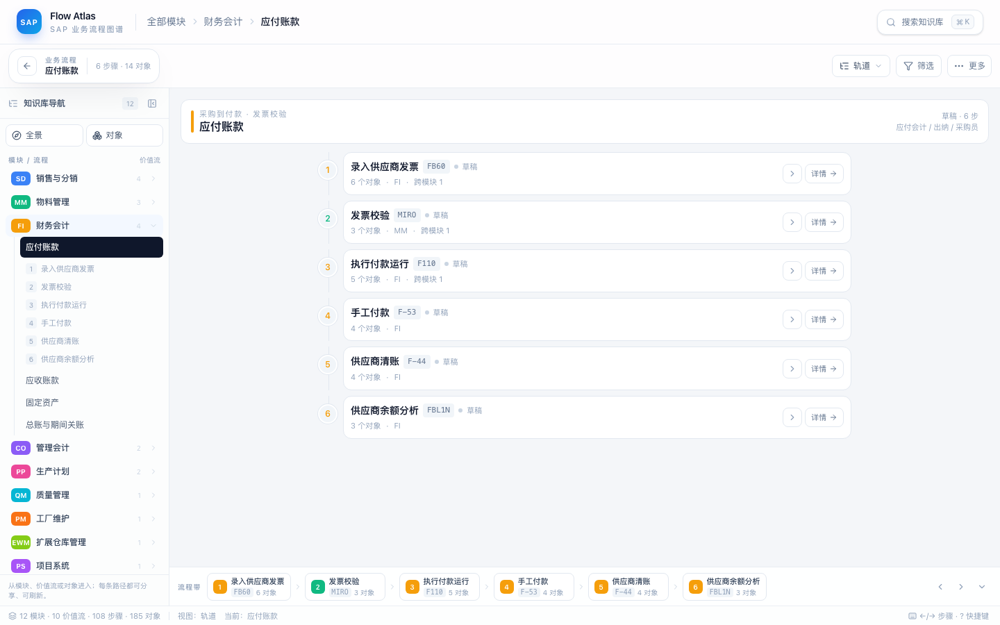
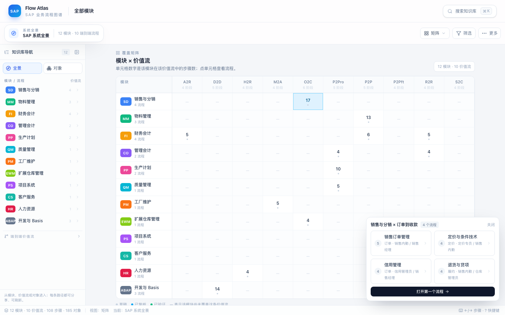
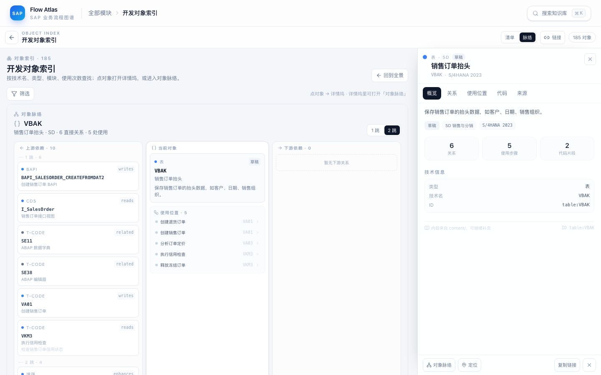
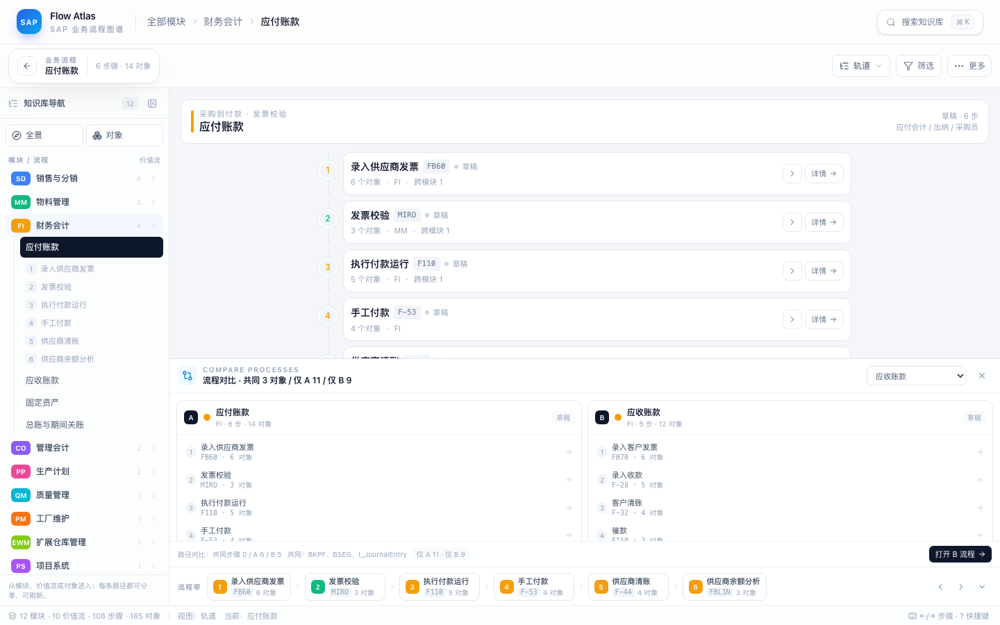
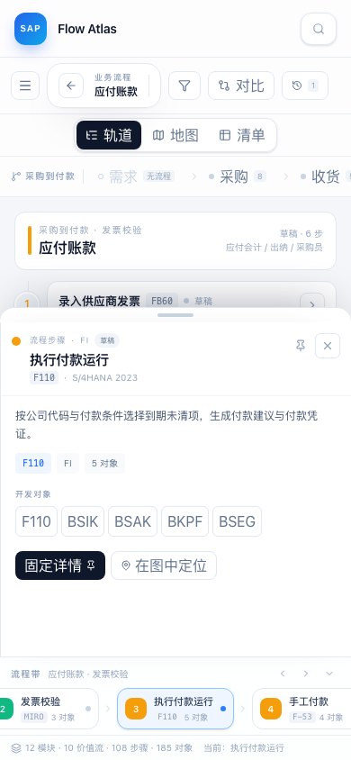
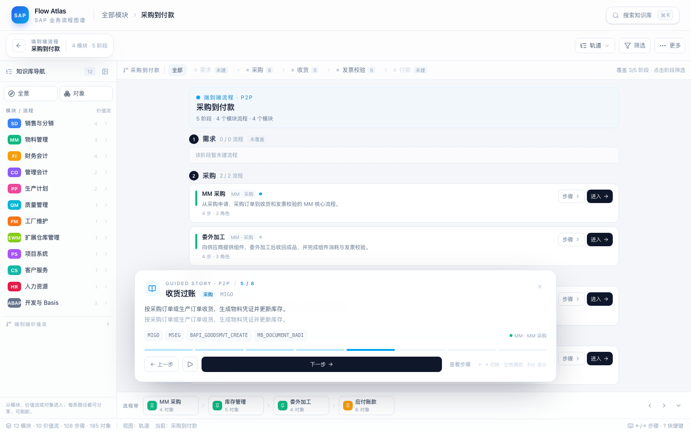
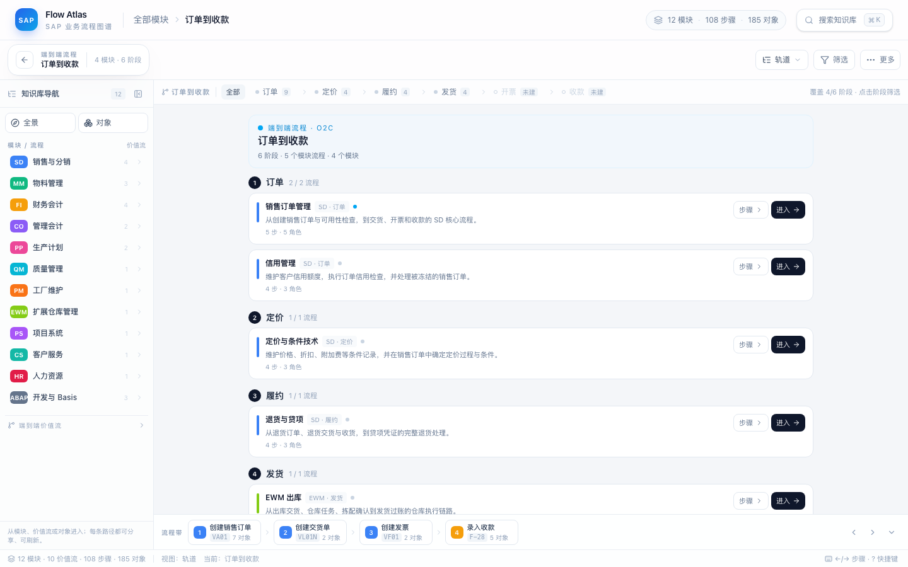
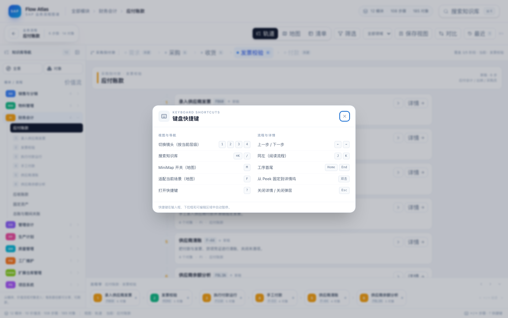

# 11 · 多视图工作台：非 SAP 开源对标与界面升级建议

> 调研日期：2026-11-25。范围：GitHub 上的非 SAP 开源项目，重点看「流程/知识/关系」类产品的总览与细节交互。
> 关联文档：[02 信息架构](02-information-architecture.md)、[10 交互审查](10-interaction-review.md)、[ADR-0001](adr/0001-canonical-graph-and-view-layouts.md)。
> 说明：本文的「可借鉴」是交互模式层面的借鉴，不代表照搬视觉或信息密度；SAP Signavio 等 SAP 产品不在本次 GitHub 对标范围内，已在 10 号文档单独分析。
> 计数说明：本文提到的 108 步骤 / 185 对象是评审时快照；2026-11-26 已扩到 184 步骤 / 280 对象，最新覆盖见 [12 号文档](12-content-map.md)。

## 0. 结论先行

当前产品**不缺功能，也不缺内容**：四层下钻、语义缩放、Hover 钉住、对象聚焦、MiniMap、Story、Compare、最近访问都已具备。真正的问题是：

1. **总览被绑在「缩小」上**。流程有几步、现在第几步、跨了哪些阶段，要靠视口和记忆回答，而不是靠一个始终可见的结构。
2. **细节被绑在「覆盖式检查器」上**。480px 的抽屉打开后，画布上下文被遮住；关掉后又要重新找回位置。
3. **一张画布同时承担「找、看、比、讲」四件事**。当内容到 108 步骤 / 185 对象，单一表现形式的边际收益迅速下降。
4. **导航与画布耦合**。左侧导航只在 ≥1400px 出现，1440px 下也只有 248px、9–10px 字号；流程一多就变成「在画布里找画布」。
5. **流程层级与阶段语义没有完全对齐**。O2C 有 6 个阶段，场景只画 4 个主干步骤，用户会问「定价/信用/退货在哪」。

建议把界面从「一张画布 + 一个覆盖式检查器」升级为：

> **一个工作台 + 四种镜头 + 一条流程带 + 一个可停靠详情坞。**
> 空间负责关系，结构负责定位，轨道负责顺序，详情坞负责细节。

具体说：

- **四种镜头**：Map（空间图）、Track（流程轨道）、Matrix（覆盖矩阵）、Table（清单）。同一份内容，按任务切换，不新增内容。
- **一条流程带**：在流程/流程步骤页底部常驻，显示阶段、步骤序号、T-Code、状态、对象数；键盘 ←/→ 即可逐步阅读。
- **一个详情坞**：Peek（轻预览）→ Pin（固定）→ Split（并排/对比）三档；可拖拽宽度，可停靠右侧或底部，打开时不遮住当前节点。
- **一个选中态**：所有镜头共享 `selection`；点 Track 里的步骤，Map 同步高亮；点 Map 的节点，Track 和详情坞同步。
- **URL 即工作台**：`view`、`filter`、`step`、`object`、`compare`、`storyStep` 都可分享、可刷新、可后退。

落地顺序建议：**P0 先把「流程带 + 阶段轨 + Track + 详情坞 + 字号」做出来**，这是用户感知最强、且不需要改内容的五件事；P1 再做 Matrix / Table / 过滤 / 对象索引 / 对比；P2 再做角色视图与移动端 bottom sheet。

---

## 1. 当前界面：已经有什么，卡在哪里

### 1.1 现状结构

| 区域 | 当前实现 | 观察 |
| --- | --- | --- |
| 顶部 | 56px 场景栏：场景胶囊、价值流菜单、Compare、Story、Recent、Map、提示 | 功能都在这，但「看待流程的方式」没有入口 |
| 左侧 | 248px「知识库导航」，仅 `min-width: 1400px` 显示 | 信息架构对，但出现门槛高、字号 9–10px、只列模块/流程/步骤 |
| 画布 | React Flow；`fitView` 450ms；语义缩放 4 档；MiniMap 168×110 | 空间关系表达好；但总览和导航都依赖相机 |
| 检查器 | 右侧固定 480px 覆盖式抽屉，5 个 Tab | 信息完整；但遮挡上下文，不能调整宽度/并排 |
| 流程页 | 5–6 个步骤卡片，蛇形布局，底部图例 | 单条流程可读；看不到阶段全貌与流程间关系 |
| 移动端 | 按场景分组纵向卡片列表 + 全宽检查器 | 可读；与桌面不是同一套「镜头」心智 |

### 1.2 数据其实已经够用

不需要为了新界面新增一套内容。现有 canonical graph 已经能派生出绝大多数视图：

| 数据 | 已经有什么 | 可以派生什么 |
| --- | --- | --- |
| `flow.stages` | 每条 flow 的阶段（O2C 6 个、P2P 5 个），每阶段 `primaryModule` | 阶段轨、覆盖矩阵的列、Story 章节 |
| `flow.processes` | 端到端流程包含的模块流程 | 某阶段下有哪些流程、哪些阶段未覆盖 |
| `process.steps` / `process.edges` | 有序步骤 + 顺序/分支边 | 流程带、Track、清单、对比 |
| `step.objects` / `objectUsage` | 步骤用的对象、对象被哪些步骤使用 | 对象索引、Where Used、对象脉络 |
| `object.relations` | 对象间关系 | 对象关系图、上下游聚焦 |
| `scene` | 每个场景的坐标、分组、边 | Map 镜头；不阻塞其他镜头 |
| `status` / `sources` | 内容状态与来源 | 过滤、矩阵状态色、详情页证据 |

这正是 ADR-0001 的延伸：**内容图只有一份，视图布局可以有多份**。现在需要从「一份画布布局」扩展到「多种派生镜头」。

### 1.3 十个具体摩擦

| # | 摩擦 | 现状证据 | 用户代价 | 优先级 |
| --- | --- | --- | --- | --- |
| 1 | 总览依赖缩小/平移 | 流程页只有画布 + fitView；没有始终可见的步骤索引 | 进入流程后先「找自己在哪」 | 高 |
| 2 | 细节遮挡上下文 | 检查器 `width: min(480px, calc(100vw - 32px))` 且覆盖在画布上 | 看详情时看不到相关节点，关闭后丢失位置 | 高 |
| 3 | 只有一种表现 | 所有层级最终都落到 React Flow | 想横向对比、批量扫描时效率低 | 高 |
| 4 | 流程阶段与画布不一致 | O2C 6 阶段，场景只画 4 个主干步骤 + note | 用户以为流程只有 4 步 | 高 |
| 5 | 过滤只是淡化 | 对象类型筛选通过 `dimmed` 淡化，不隐藏 | 185 个对象时，视觉噪音仍在 | 高 |
| 6 | 导航门槛高 | 左侧导航 `min-[1400px]:flex`；1440px 下只有 248px | 1280/1366 笔记本没有持久导航 | 中高 |
| 7 | 字号过小 | 导航/节点元信息大量 9–10px | 长时间阅读疲劳，投影/演示不可读 | 中高 |
| 8 | 价值流发现性弱 | 10 条价值流收在右上角菜单；首页只画 4 条 | 新用户以为只有 4 条端到端流程 | 中 |
| 9 | 对比是模态 | Compare 以面板/模态覆盖画布 | 无法边看 A 边看 B | 中 |
| 10 | 移动端是另一套 | 卡片列表 + 全宽检查器 | 跨端连续性和「位置感」不足 | 中 |

### 1.4 根因

不是某个组件做得不好，而是**把四种不同任务压进了同一个通道**：

- 找：有哪些模块/流程/步骤 → 需要**结构**（树、矩阵、清单）
- 看：这条流程怎么走 → 需要**顺序**（轨道、流程带）
- 比：两条流程差在哪 → 需要**并排**（split、diff）
- 讲：给新人讲一遍 → 需要**叙事**（Story、播放、聚焦）

一张无限画布擅长「关系」，不擅长「顺序」和「批量扫描」；一个覆盖式抽屉擅长「完整」，不擅长「保持上下文」。所以不是把画布做得更大，而是**让不同任务有各自合适的镜头，并共享同一个选中态**。

---

## 2. GitHub 对标：非 SAP 项目地图

> 星数为 2026-11-25 通过 GitHub API 采样，会持续变化；许可以仓库为准，表中只标注明确识别的类型。

### 2.1 主表：最值得看的 18 个项目

| 项目 | 类型 | 星数 | 最值得借鉴的界面模式 | 不要照搬 |
| --- | --- | ---: | --- | --- |
| [apache/airflow](https://github.com/apache/airflow) | 工作流编排 | 47.7k | 同一条 DAG 的 8 个 Tab：Overview / Grid / Graph / Runs / Tasks / Events / Code / Details | 运维指标、运行实例密度 |
| [n8n-io/n8n](https://github.com/n8n-io/n8n) | 可视化工作流 | 212k | 画布 + 侧栏 NDV + Focus Panel + Canvas Groups | 节点参数表单、编辑态 |
| [temporalio/temporal](https://github.com/temporalio/temporal) | 工作流执行 | 24.6k | Event History 的 Timeline / All / Compact / JSON 四种读法 | 原始事件 JSON 直接暴露 |
| [dagster-io/dagster](https://github.com/dagster-io/dagster) | 数据资产编排 | 16.5k | Asset Graph + 资产详情 + 全局血缘 | 资产健康指标堆叠 |
| [kiali/kiali](https://github.com/kiali/kiali) | 服务网格拓扑 | 3.7k | 侧栏选中 + 双击节点进入 Detail Graph + 图例/流量开关 | 实时流量动画的「假数据」风险 |
| [datahub-project/datahub](https://github.com/datahub-project/datahub) | 数据血缘 | 13k | Lineage Tab + Impact Analysis + 列级聚焦（面包屑） | 企业元数据的高密度 Tab |
| [likec4/likec4](https://github.com/likec4/likec4) | 架构模型可视化 | 6.2k | 模型 → 多种视图；Dynamic View 用有序步骤讲故事 | 只读静态图、DSL 门槛 |
| [structurizr/structurizr](https://github.com/structurizr/structurizr) | C4 架构模型 | 568 | 一个模型生成系统上下文/容器/组件/动态/部署多种视图 | 纯静态导出、无交互 |
| [CoatiSoftware/Sourcetrail](https://github.com/CoatiSoftware/Sourcetrail) | 代码关系探索 | 16.5k | Search + Graph + Code 三视图；图聚焦当前符号的入/出依赖 | 桌面端重交互、仅代码域 |
| [google/perfetto](https://github.com/google/perfetto) | Trace 时间线 | 6.8k | 时间线 + Current Selection + 区域选择 + 全键盘 + 命令面板 | 没有时间数据时硬做时间轴 |
| [jaegertracing/jaeger](https://github.com/jaegertracing/jaeger) | 分布式追踪 | 23.4k | Trace 时间线 + Span 详情 + 服务/操作过滤 | 纯运维视角 |
| [bpmn-io/bpmn-js](https://github.com/bpmn-io/bpmn-js) | BPMN 渲染/建模 | 9.7k | BPMN 画布、导航、属性面板、Viewer/Modeler 分离 | BPMN 记号与建模器复杂度 |
| [process-analytics/bpmn-visualization-js](https://github.com/process-analytics/bpmn-visualization-js) | 流程执行可视化 | 290 | 在 BPMN 上叠加执行数据（overlay / highlight） | 为可视化引入 BPMN 语义负担 |
| [xyflow/xyflow](https://github.com/xyflow/xyflow) | 节点画布 SDK | 39.1k | MiniMap、Panel、NodeToolbar、viewport API、自定义 DOM 节点 | 自由拖拽编辑 |
| [tldraw/tldraw](https://github.com/tldraw/tldraw) | 无限画布 SDK | 51.6k | 相机/缩放/多选/UI 分区等画布手感 | 自由白板替代语义流程 |
| [toeverything/AFFiNE](https://github.com/toeverything/AFFiNE) | 文档 + 白板 | 78.3k | 文档模式与 edgeless 模式并存，同一内容两种看法 | 编辑态与协作噪声 |
| [antvis/G6](https://github.com/antvis/G6) | 图可视化框架 | 12.4k | FishEye 焦点+上下文、Combo 分组、MiniMap、TimeBar | 力导向「毛线球」 |
| [excalidraw/excalidraw](https://github.com/excalidraw/excalidraw) | 手绘白板 | 136k | 无限画布、缩放/平移、导出与分享的手感 | 手绘风格与自由绘图 |

### 2.2 八个深挖：它们到底解决了什么问题

#### 2.2.1 Airflow：同一条流程，八种读法

Airflow 3 的 DAG 详情页把「一条流程」拆成多个 Tab：Overview 看最近失败与运行计数，Grid 看状态热力图，Graph 看任务依赖，Runs 看运行历史，Tasks 看聚合统计，Events 看事件，Code 看源码，Details 看元数据。

- **可借鉴**：不是给流程加更多节点，而是给同一份流程提供**不同问题的入口**。我们的四个镜头可以沿用这个结构：Map 看关系、Track 看顺序、Matrix 看覆盖、Table 看批量。
- **可借鉴**：Airflow 的 Tab 名称就是用户问题（Runs / Tasks / Code），不是内部实现名。我们的镜头名也应该是「地图 / 轨道 / 矩阵 / 清单」，而不是 `canvas-v2`。
- **别照搬**：Airflow 的核心是运行实例、状态、重试、日志；我们没有运行数据，不应该做「假的运行态」。

- 文档：[Airflow UI Overview](https://airflow.apache.org/docs/apache-airflow/stable/ui.html)

#### 2.2.2 n8n：画布不负责一切，侧栏负责细节

n8n 的核心操作是「在画布上搭流程」，但它的细节并不都塞进节点卡片：选中节点后，右侧出现 Node Detail View（NDV），可以在不离开画布的情况下看参数、输入/输出数据、执行结果；近期又把 NDV 与 Focus Panel 合并，支持把参数/详情固定在画布旁边。Canvas Groups 则让大流程可以分组折叠。

- **可借鉴**：**画布 + 侧栏**是可行组合，关键是侧栏不遮住当前节点，并且与画布共享选中态。
- **可借鉴**：分组（Canvas Groups）比「缩小后什么都看不见」更适合大流程；我们的阶段分组可以做成可折叠的 Track 段。
- **别照搬**：n8n 是编辑器，参数表单、连线、运行调试占了大半界面；我们是只读知识库，应该更轻。

- 参考：[n8n Focus Panel PR #17734](https://github.com/n8n-io/n8n/pull/17734)、[Canvas Groups 文档](https://docs.n8n.io/build/understand-workflows/workflow-components/canvas-groups/)

#### 2.2.3 Kiali：侧栏是「选中了什么」，双击是「进入它」

Kiali 的 Topology 图里，单击节点/边/框，右侧可折叠 Side Panel 汇总当前选择：流量、响应时间、健康、响应码、相关 Trace；双击节点则进入该节点的 Detail Graph，只显示以它为中心的流量；再双击可切换中心。

- **可借鉴**：**单击 = 选中并看摘要，双击 = 以它为中心下钻**。这比「单击直接打开一个满屏抽屉」更符合探索节奏。
- **可借鉴**：Side Panel 同时支持「选中单个元素」和「选中整张图」两种上下文，面板内容随选择变化，而不是固定 Tab。
- **别照搬**：Kiali 的流量动画、请求率、错误率都依赖实时指标；我们只能表达静态关系，不能伪装实时。

- 文档：[Kiali Topology](https://kiali.io/docs/features/topology/)

#### 2.2.4 DataHub：血缘不是一个页面，而是一种「聚焦」

DataHub 的 Lineage Tab 支持表级与列级血缘；可以在图上展开列、悬停/点击有血缘的列；当图太忙时，点击列面包屑可以**只看这一列的血缘**；Impact Analysis 则从「如果改这个资产，会影响谁」反向看。

- **可借鉴**：**聚焦（focus）不是过滤掉一切，而是把当前对象的上/下游保持在上下文里**。我们的对象检查器可以加「只看相关步骤/只看相关对象」的聚焦开关，而不是只做淡化。
- **可借鉴**：血缘的「上游/下游」方向可以直接映射到 SAP 的「前置步骤/后置步骤」「输入/输出对象」。
- **别照搬**：DataHub 面向数据平台管理员，Tab 和字段极多；我们的对象页应保持 5 个以内的区块。

- 文档：[DataHub Lineage](https://docs.datahub.com/docs/features/feature-guides/lineage)

#### 2.2.5 Temporal：同一段历史，按需要压缩或展开

Temporal Web UI 的 Workflow History 提供四种读法：Timeline（按时间正/倒序，点事件看详情）、All（全部事件）、Compact（把 Activity / Signal / Timer 逻辑分组）、JSON（完整原始数据）。

- **可借鉴**：细节不是只有「展开/收起」两态，而是**多种压缩级别**。我们的步骤详情也可以有「摘要 / 完整 / 原始来源」三档；对象关系可以有「只看一跳 / 两跳 / 全部」。
- **可借鉴**：Timeline 的「点事件看详情」与我们的流程带 + 详情坞是同一模式：**列表负责定位，详情负责解释**。
- **别照搬**：Temporal 的事件是技术事件，数量多、命名长；我们的步骤是业务步骤，应该用业务语言，不暴露内部 JSON。

- 文档：[Temporal Web UI](https://docs.temporal.io/web-ui)

#### 2.2.6 Perfetto：键盘是主交互，鼠标是补充

Perfetto 的 Trace Viewer 用 WASD 缩放/平移，`.`/`,` 在同轨相邻 slice 间移动，`F` 适配选中，拖拽做区域选择，`Ctrl+Shift+P` 打开命令面板；选中后在 Current Selection 标签里看详情。

- **可借鉴**：流程阅读天然适合键盘：←/→ 上一步/下一步，`F` 适配当前步骤，`/` 搜索，`1–4` 切镜头。
- **可借鉴**：**选择要有明确的「当前选择」区域**，而不是只靠节点边框。我们的流程带就是「当前选择」的常驻表达。
- **别照搬**：Perfetto 的时间轴依赖精确时间戳；我们的流程只有顺序和阶段，硬做 Gantt 会制造错误精度。

- 文档：[Perfetto UI](https://perfetto.dev/docs/visualization/perfetto-ui)

#### 2.2.7 LikeC4 + Structurizr：模型只有一份，视图可以很多

LikeC4 明确把 View 定义为「模型的一个投影」：同一模型可以生成元素视图、Dynamic View（按有序步骤讲一个场景，可渲染成图或时序图）、Deployment View；模型变化时所有视图同步更新。Structurizr 同样用一份 C4 模型生成系统上下文、容器、组件、动态、部署等多张图。

- **可借鉴**：**视图是模型的投影，不是内容副本**。我们的 Track / Matrix / Table 都应该从 `flow/process/step/object` 派生，而不是再写一份 YAML。
- **可借鉴**：Dynamic View 的「有序步骤」正好对应我们的 Story / 流程带；它支持 parallel / opt / loop 等块，提醒我们流程不总是单线。
- **别照搬**：LikeC4/Structurizr 的图偏静态架构图，交互以查看为主；我们的流程需要更强的「逐步阅读 + 对象下钻」。

- 文档：[LikeC4 Views](https://likec4.dev/dsl/views/)、[LikeC4 Dynamic Views](https://likec4.dev/dsl/views/dynamic/)、[Structurizr README](https://github.com/structurizr/structurizr)

#### 2.2.8 Sourcetrail + G6：搜索、关系图、代码/细节，三件事分开做

Sourcetrail 把代码探索拆成三个互动视图：Search 快速定位符号，Graph 显示当前符号的入/出依赖，Code 显示该符号的所有源码位置；点另一个位置就继续深入。G6 则提供 FishEye（焦点放大、上下文保留）、Combo（分组）、MiniMap、TimeBar 等图交互插件。

- **可借鉴**：**搜索负责定位，图负责关系，代码/详情负责解释**。我们已经有 ⌘K 和检查器，但搜索与画布/详情没有形成「三视图」的协同。
- **可借鉴**：FishEye 是「焦点+上下文」的极端实现；我们不需要默认开启，但可以在对象聚焦时提供「放大相关、保留周边」的选项，替代一刀切的淡化。
- **别照搬**：Sourcetrail 是桌面 IDE 式三栏，信息密度极高；G6 的力导向图不适合表达有方向的业务流程。

- 参考：[Sourcetrail 文档](https://github.com/CoatiSoftware/Sourcetrail/blob/master/DOCUMENTATION.md)、[G6 FishEye](https://g6.antv.antgroup.com/en/manual/plugin/Fisheye/)

### 2.3 三条反例：看起来像，但不该照搬

1. **自由白板**（tldraw / Excalidraw / AFFiNE）：自由度极高，但不表达方向、层级、业务约束；我们的节点位置应由场景/布局维护，不能让用户拖出新事实。
2. **运维 Dashboard**（Airflow / Kiali / Grafana）：它们回答「现在运行得怎么样」，我们回答「业务上怎么走、用到什么」；没有运行数据就不要做运行态指标。
3. **企业元数据大全**（DataHub / OpenMetadata / Backstage）：字段和 Tab 极多，适合管理员；我们的读者是顾问/开发/学习者，应该用渐进披露，而不是一次给全。

---

## 3. 可复用的十个模式

| # | 模式 | 一句话 | 代表项目 | 在本项目怎么用 |
| --- | --- | --- | --- | --- |
| 1 | 一模型多视图 | 内容只有一份，视图是投影 | Structurizr / LikeC4 | Track/Matrix/Table 全部从 canonical graph 派生 |
| 2 | 多镜头同一选中态 | 换视图不丢选中与位置 | Airflow / Temporal | `selection` 共享；URL 保留 step/object/view |
| 3 | 总览独立于相机 | 不靠缩小也能看到全貌 | Airflow Grid / 流程带 | 流程带 + 阶段轨 + Matrix |
| 4 | Peek → Pin → Split | 细节有三档，不是开/关 | n8n / Kiali / Sourcetrail | 轻预览 / 固定详情坞 / 并排对比 |
| 5 | 焦点 + 上下文 | 聚焦相关，但保留周边 | G6 FishEye / Kiali / DataHub | 对象聚焦 + 「只看相关」硬过滤 + 可回退 |
| 6 | 结构与空间分工 | 树负责定位，图负责关系 | Sourcetrail / Kiali | 左导航树 + 中间镜头 + 右侧详情 |
| 7 | 任务型 URL | 视图/过滤/选中都可分享 | Temporal Saved Views / Perfetto | `?view=track&filter=...&step=...` |
| 8 | 三层密度 | 摘要 / 预览 / 完整 | Airflow / Temporal Compact | 节点卡 → Peek → 详情坞 |
| 9 | 键盘优先 | 阅读流程像翻页 | Perfetto | ←/→、J/K、F、/、1–4、Esc |
| 10 | 叙事/播放 | 用步骤讲一个场景 | LikeC4 Dynamic / token simulation | 把 O2C Story 泛化为任意 flow 的 Story |

---

## 4. 目标方案：Atlas Workbench

### 4.1 六条设计原则

1. **任务选镜头，不是层级选界面。** 流程页默认 Track，系统全景默认 Map；但用户随时可以切，切完不丢选中、不丢过滤。
2. **一个选中态，多个镜头联动。** `selection = { kind, id, context }` 是唯一真相；Map 高亮、Track 展开、Table 选中、详情坞打开，都由它驱动。
3. **总览是独立视图，不是缩小结果。** 流程带、阶段轨、Matrix 都是「不缩放也能看到全貌」的视图。
4. **细节分三层，不打断上下文。** 节点卡（3–5 个线索）→ Peek（320px 轻预览）→ Dock（完整详情）。需要对比时再 Split。
5. **结构与空间并存。** 左侧树回答「我在哪」，中间镜头回答「这里有什么」，右侧坞回答「这一步是什么」。
6. **不伪造数据，不制造配置地狱。** 没有运行时长就不做 Gantt，没有事件日志就不做流程挖掘指标；只提供四种固定镜头 + Story，不做用户自定义布局。

### 4.2 布局：三栏 + 一条流程带 + 一条状态栏

```text
┌──────────────────────────────────────────────────────────────────────────────┐
│ 48  Flow Atlas  /  SD  /  订单管理        ⌘K   [地图][轨道][矩阵][清单]  筛选 2 │
├──────────────┬───────────────────────────────────────────────┬───────────────┤
│ 导航 240      │ 阶段轨   订单 ─ 定价 ─ 履约 ─ 发货 ─ 开票 ─ 收款 │ 详情 420–560  │
│              │ ┌───────────────────────────────────────────┐ │ 标题 / T-Code  │
│ 模块          │ │                                           │ │ 概览 对象 代码 │
│ 端到端流程    │ │              当前镜头                      │ │ 跨模块 来源    │
│ 模块流程      │ │        Map / Track / Matrix / Table        │ │               │
│ 步骤          │ │                                           │ │ 相关步骤       │
│ 我的视图      │ └───────────────────────────────────────────┘ │ 使用位置       │
│              │ 流程带  ①VA01 ②VL01N ③VF01 ④F28 …            │ 上一/下一步    │
├──────────────┴───────────────────────────────────────────────┴───────────────┤
│ 108 步骤 · 185 对象 · 已选 VA01 · 100% · ? 快捷键                           │
└──────────────────────────────────────────────────────────────────────────────┘
```

布局规则：

- 顶部栏 48–56px；只放全局导航、搜索、镜头切换、筛选、更多。统计数字从顶栏移到状态栏/全景页，全局 Header 不再重复内容规模。
- 左侧 `--rail` 默认 248px，可折叠为 56px 图标栏；≥1440 常驻，1024–1439 默认折叠/悬浮，<1024 抽屉。
- 中间 `minmax(0, 1fr)`；阶段轨只在端到端流程页出现（约 40px），流程页直接进入镜头区；底部流程带 56px（可折叠为 36px）。
- 右侧 `--dock` 默认 440px，范围 360–640px；桌面是**网格列**而不是覆盖层，选中节点不会被遮住；1024–1279 仍用右列，<1024 改为底部抽屉/Sheet。
- 状态栏 28px：显示计数、当前选中、缩放/位置、快捷键入口；比顶栏更适合放「上下文」。
- 所有面板分隔线用 1px `#E2E8F0`，不要用重阴影制造“很多层”。

### 4.3 四种主镜头 + 两种辅助模式

| 镜头 | 回答的问题 | 主要结构 | 默认用于 | 细节入口 |
| --- | --- | --- | --- | --- |
| **Map 地图** | 它们在哪里、彼此什么关系？ | React Flow 场景 + 语义缩放 + MiniMap | 系统全景、模块工作区、ABAP 地图 | Hover 卡 → Peek → Dock |
| **Track 轨道** | 这条流程按什么顺序走？每一步做什么？ | 纵向步骤轨道 + 阶段分隔 + 行内展开 | 流程页、端到端流程页 | 行内展开 / Dock |
| **Matrix 矩阵** | 哪些模块参与了哪些流程？覆盖到哪？ | 模块 × 流程/阶段网格 + 计数 + 状态 | 系统全景、模块概览 | 单元格 → 列表 → Dock |
| **Table 清单** | 有哪些步骤/对象？怎么批量筛？ | 可排序、可过滤、可展开的表格 | 对象索引、步骤总表、对比 | 行展开 / Dock |
| **Story 故事** | 给新人怎么讲这条流程？ | 覆盖在 Track/Map 上的步骤叙事 + 上一步/下一步 | 端到端流程 | 故事卡 + Dock 同步 |
| **Lineage 脉络** | 这个对象被谁用、影响谁？ | 左/右向关系图 + Where Used 列表 | 对象详情 | 点节点 → Dock |

> 四种主镜头是 Map / Track / Matrix / Table，放在顶部切换；Story 是覆盖在 Track/Map 上的叙事模式，Lineage 是从对象详情进入的辅助模式，不占顶层导航。

**默认镜头按层级分配**（这是「合适」的关键，不是让用户每次自己选）：

| 层级 | 默认 | 备选 | 理由 |
| --- | --- | --- | --- |
| Universe 系统全景 | Map | Matrix / Table | 12 个模块，空间关系比列表更直观 |
| Module 模块工作区 | Map | Track / Table | 流程卡片 + 阶段分组，保留空间感 |
| Process 流程 | **Track** | Map / Table | 5–6 步是顺序问题，纵向轨道一屏读完 |
| Flow 端到端流程 | **Track** | Map / Story | 阶段 + 主干步骤，先读顺序再看关系 |
| Object 对象 | Lineage | Table | 关系与使用位置比卡片更有用 |

> Story 不是第五个 Tab，而是 Track/Map 上的一层「讲解状态」；Lineage 只在对象上下文出现。

#### Track 轨道：流程页的新默认

Track 不是另一张画布，而是一条**纵向的流程清单**：一屏能看到全部步骤，点一行就能展开细节。它解决「不想缩放、只想顺序读完」的需求。

```text
┌ 应付账款 · 6 步 · 14 对象 ─────────────────────────────────────── [地图] [清单] ┐
│                                                                              │
│  ①  ● 录入供应商发票        FB60     draft     3 对象      [展开]            │
│  │     手工录入供应商发票，生成应付凭证与 GR/IR 清账。                        │
│  ▼                                                                           │
│  ②  ● 发票校验              MIRO     reviewed  3 对象      [展开]            │
│  │     把供应商发票与采购订单、收货凭证做三方匹配，形成应付。                  │
│  ▼                                                                           │
│  ③  ● 执行付款运行          F110     reviewed  3 对象      [展开]            │
│  │     按公司代码与付款条件选择到期未清项，生成付款建议与付款凭证。            │
│  ▼                                                                           │
│  ④  ● 手工付款              F-53     draft     3 对象      [展开]            │
│  …                                                                           │
│                                                                              │
│  阶段：发票校验 · 角色：应付会计 / 出纳 · 流程：P2P · 上游：MM 收货            │
└──────────────────────────────────────────────────────────────────────────────┘
```

Track 的规格：

- 行高 56–64px；左侧序号 + 连接线；中间标题、T-Code、状态与对象数；右侧展开按钮。摘要、输入/输出和对象 chips 只在展开后出现。
- 点击行 = 选中 + 打开 Peek；再次点击/「展开」= 行内展开 3–5 条关键信息（输入/输出/对象 chips/跨模块）；「在详情坞打开」进入完整详情。
- 阶段分隔条：显示阶段名、阶段内步骤数、主模块色条；点击阶段可折叠。
- 分支边不用画箭头，用「分支」标签 + 缩进行表达；复杂分支再切 Map。
- 纯 DOM + CSS，支持文本选择、复制、屏幕阅读器、键盘上下移动。
- 在 1280px 宽度、右侧坞打开时仍能一屏看到 6–7 行；不需要缩放。

#### Map 地图：保留，但不再承担全部

- 保留现有 React Flow 场景、节点卡、语义缩放、MiniMap、Hover 钉住。
- 把「总览/定位」交给阶段轨、MiniMap、流程带；Map 只负责「关系与空间」。
- 默认 `maxZoom` 1.15，避免一进来就是特写；节点卡默认只显示标题 + T-Code + 对象数，摘要移到 Hover/Peek。
- 选中对象时，Map 用「聚焦 + 上下文」：相关步骤高亮、其余降透明度；提供「只看相关」开关做硬过滤。
- 增加 `F` 适配选中、`O` 全图、`M` MiniMap；MiniMap 默认收起，避免右下角堆叠。

#### Matrix 矩阵：回答「覆盖」而不是「关系」

系统全景/模块页的第二种镜头，用模块 × 流程（或流程 × 阶段）表达覆盖面：

```text
             O2C   P2P   R2R   A2R   H2R   …
SD            ●4    ○     ○     ○     ○
MM            ●1    ●3    ○     ○     ○
FI            ●2    ●2    ●4    ●2    ○
CO            ○     ○     ●3    ●3    ○
…
```

- 单元格：主数字 = 该模块在该流程中的步骤数；小点 = 状态（draft/reviewed/verified）；空 = 未覆盖。
- 悬停显示「哪些流程/步骤」；点击单元格 → 下方列表（process list）→ 再点进 Track/Dock。
- 行/列可排序、可筛选（模块、状态、流程）；首列与表头 sticky。
- 不做「热度」色阶造假；如果要用颜色，只用计数深浅，并在图例说明。

#### Table 清单：批量扫描与精确跳转

- 三种表：流程表、步骤表、对象表；列可按需显示。
- 行内展开：摘要、对象 chips、跨模块、来源；不离开表。
- 选中行 → Dock；双击 → 进入对应场景。
- 适合「FI 有哪些 reviewed 的 BAPI 相关步骤」这类问题；配合过滤条使用。

#### Story 故事：把「讲一遍」变成一等模式

- 不是独立页面，而是覆盖在 Track/Map 上的模式：底部叙事条 + 高亮当前步骤 + 详情坞同步。
- 上一步/下一步/自动播放/暂停；键盘 ←/→/空格；URL `story=...&storyStep=3`。
- 每个故事步骤包含：`scene`、`stepId`、`objectId?`、一句讲解、可选的「看细节」按钮。
- 把现有 O2C 6 步故事泛化：按 flow.stages 选 5–8 个代表步骤，内容仍来自 canonical graph，不新增事实。

### 4.4 底部流程带（Path Band）

这是「快速统览流程」的最小、最高性价比组件，P0 必做。

```text
┌ 应付账款 · 6 步 · 所属阶段：发票校验 ─────────────────────── [展开] [全图] ┐
│  ① FB60   ② MIRO   ③ F110   ④ F-53   ⑤ F-44   ⑥ FBL1N   ← →           │
│  ●        ●        ●        ●        ●        ●                          │
└──────────────────────────────────────────────────────────────────────────────┘
```

规格：

- 位置：中间区底部，横跨画布/轨道；不覆盖右侧详情坞。
- 高度 56px，可折叠为 36px；折叠后仍显示「3 / 6 · F110」和前后箭头。
- 数据：`process.steps`（顺序）+ 每步 `status`/`objects.length`；流程页只显示该 process 的 `stage`，不虚构步骤到阶段的映射。端到端流程页按 `process.stage` 分组，才显示多阶段分隔。
- 交互：
  - 点击步骤 → 选中 + Peek；双击 → Pin 到详情坞；
  - ←/→ 切换上一步/下一步；Home/End 到首尾；
  - hover 步骤 → Map 对应节点高亮；
  - 端到端流程页点击阶段分隔 → 跳到该阶段下的 process；没有 process 时提示「该阶段暂未建流程」；
  - 当前步骤自动滚入可视区（`scrollIntoView({ block: 'nearest', inline: 'center' })`）。
- 语义：**当前焦点**，不是「已完成」。没有运行数据，不要做进度百分比。
- 可访问性：`<nav aria-label="流程步骤">`；按钮 `aria-current="step"`；键盘焦点可见；屏幕阅读器播报「第 3 步，共 6 步，F110 执行付款运行」。
- 移动端：变成底部横向滚动胶囊，固定在 bottom sheet 上方；点击打开 sheet。

### 4.5 阶段轨（Stage Rail）

放在端到端流程页的顶部（流程带在底部），用来解决「流程层级 vs 阶段语义」不一致；流程页不重复显示，只保留标题中的当前阶段。

```text
应付账款   需求 ─ 采购 ─ 收货 ─ 发票校验 ─ 付款
           ○     ○     ○     ●         ○          当前：发票校验（FI）
```

- 数据来自 flow 的 `stages`；端到端流程页用 `stage` 参数高亮当前阶段。
- 每个阶段显示：名称、该阶段的 process 数、是否有未覆盖；点击跳到该阶段下的流程（若有），没有则显示「该阶段暂未建流程」而不是空白。
- 阶段轨同时承担「我在整条价值流的哪里」：比面包屑更细，比画布更稳定。
- 端到端流程页可把阶段轨做成「阶段 + 主干步骤」两行；流程页不显示阶段轨。

### 4.6 详情坞（Detail Dock）

把现有 Inspector 从「固定 480px 覆盖层」升级为「可停靠、可调整、可分屏」的详情容器。

| 状态 | 宽度/高度 | 触发 | 行为 |
| --- | --- | --- | --- |
| 关闭 | 0 | 默认 | 画布/轨道全宽 |
| **Peek** | 320px（或底部 40%） | 单击节点/步骤 | 3–5 个线索 + 「固定」按钮；选另一个自动替换；Esc 关闭 |
| **Pin** | 420–560px，可拖拽 360–640 | 双击 / Enter / 点「固定」 | 完整 5 Tab；保持打开；URL 带 step/object；自动避让选中节点 |
| **Split** | 2 × 360–420px（≥1440，左导航自动折叠） | 对比 / 「在右侧打开」 | A/B 并排；共享滚动/选中；diff 标记 |
| **Bottom** | 高度 45% | 1024–1279 或用户选择 | 保留横向空间；拖拽调整；Esc 收起 |

内容结构（沿用现有 Tab，不重做信息）：

```text
┌ 创建销售订单  VA01                         SD · 订单管理 · O2C 第 2 步   [×] ┐
│ 概览 │ 开发对象 │ 代码 │ 跨模块 │ 来源                                   │
├──────────────────────────────────────────────────────────────────────────────┤
│ 一句话：销售订单的入口，确定客户、物料、数量、价格与交货日期。               │
│ 输入 / 输出 / 前置 / 后置 / 规则 / 常见坑                                   │
│ 相关步骤：上一步 报价 → 下一步 ATP 检查 → 交货                              │
│ 开发对象：T-Code ×1 · 表 ×3 · BAPI ×1 · 增强 ×1 · CDS ×1                    │
├──────────────────────────────────────────────────────────────────────────────┤
│ [← 上一步]  [在图中定位]  [复制链接]  [下一步 →]                             │
└──────────────────────────────────────────────────────────────────────────────┘
```

关键交互：

- **Peek 不是 Hover**：Hover 仍然是 3–5 个线索的浮动卡；Peek 是点击后的固定轻面板，允许移入鼠标、点对象 chips。
- **Pin 后画布让位**：如果选中节点会被坞遮住，自动 `setCenter` 偏移半个坞宽；只偏移一次，不打断用户拖动。
- **坞内面包屑**：步骤 → 对象 → 代码；`Esc` 逐级返回；`×` 关闭；浏览器后退也能回到上一级。
- **滚动位置按 Tab 记忆**；切换 Tab 不重新挂载画布；关闭再打开保留上次 Tab。
- **对比**：Split 时两个坞各自有独立选中；顶部显示「A vs B」；差异用「仅 A / 仅 B / 共有」三色标签，不用红绿对撞。
- **移动端**：bottom sheet 半屏/全屏两档；拖动把手；下滑关闭；流程带仍可见。

### 4.7 导航、过滤、搜索

#### 左侧导航

- 三组：**模块 / 端到端流程 / 我的视图**；模块展开后是流程 → 步骤。
- 字号 12px，行高 28–32px；当前项左侧 2px 色条 + 背景，不用整行黑底。
- 组内搜索（「在导航中筛选」）；对象索引入口（`#/objects`，P1）。
- 折叠为 56px 图标栏时，hover 显示 tooltip；不直接消失。
- 记住展开状态与滚动位置；URL 变化时自动展开当前路径。

#### 过滤条

放在镜头上方，而不是塞进命令面板：

```text
[模块 ▾] [对象类型 ▾] [状态 ▾] [角色 ▾] [流程 ▾]   已选 3 个 · 匹配 23/108   [仅显示匹配] [清除]
```

- 过滤条件作用于所有镜头：Map 节点、Track 行、Matrix 单元格、Table 行、流程带步骤。
- **高亮 vs 隔离**：默认高亮，提供「仅显示匹配」硬过滤；硬过滤显示匹配计数，避免「怎么都找不到」。
- URL：`filter=type:table,bapi;status:reviewed;module:fi&isolate=1`；可分享、可保存。
- 「我的视图」：localStorage 保存 name + URL + 时间；支持重命名/删除；不做后端。

#### 搜索

- ⌘K 保持现有分组；结果条目增加「在哪个流程/第几步」「对象类型/模块」。
- Enter 跳转；Shift+Enter 打开 Peek；不离开当前镜头也能预览。
- 最近搜索 + 最近访问合并为「继续」区，最多 5 条。

### 4.8 任务 → 镜头映射

| 用户任务 | 首选镜头 | 第一动作 | 细节落点 |
| --- | --- | --- | --- |
| 系统里有哪些模块/价值流？ | Map / Matrix | 看全景或矩阵 | 点模块 → Dock 概览 |
| 这条流程有几步？第 4 步是什么？ | Track + 流程带 | 扫轨道 / 点第 4 个胶囊 | Dock 概览 + 对象 |
| 这一步具体做什么？ | 任意 | 点步骤 | Dock Overview |
| 这一步用到哪些对象/代码？ | 任意 | 点对象 chip | Dock Objects / Code |
| 这个表被哪些流程用？ | Lineage | 搜对象 → Where Used | 列表 → 跳正确场景 |
| 两条流程差在哪？ | Compare Split | 选 A/B | 差异列表 → 跳转 |
| 新人怎么入门？ | Story | 打开故事 | 上一步/下一步 + Dock |
| FI 有哪些 reviewed 的 BAPI 步骤？ | Table + Filter | 筛选状态/类型/模块 | 行展开 → Dock |

### 4.9 视觉、字号与动效

字号已统一为 **6 档**，不再在组件里零散使用 8/9/13/15/17px：

| 角色 | 实际字号 | 典型用途 |
| --- | --- | --- |
| micro | 10px | 小标签、图例、状态点旁注、T-Code 辅助 |
| meta | 11px | 导航二级、卡片元信息、时间/来源 |
| body | 12px | 正文、导航一级、表单与菜单 |
| emphasis | 14px | 节点标题、步骤标题、强调文本 |
| title | 16px | 区块标题、详情坞标题、流程标题 |
| page | 20px | 页面主标题 |

实现方式：`src/styles/globals.css` 定义 `--type-micro/meta/body/emphasis/title/page`，把历史 `text-[8px]`–`text-[20px]` 统一收敛到以上六档；后续新增组件应使用语义 token，而不是继续写新的任意像素值。

其他视觉规则：

- 模块色只做 3px 侧条、缩写徽标、阶段色点；不要大面积铺色。
- 画布背景网格透明度 ≤ 6%；边默认 1.25px；边标签只在选中/Hover 时出现；路径流动动画只在当前选中路径上播放。
- 卡片圆角 12–14px；阴影两级；不要每个面板都发光。
- 动效：Hover 90ms、面板 150ms、镜头切换 250ms、相机 350ms；`prefers-reduced-motion` 下全部改为 120ms 淡入，不做位移。
- 状态不能只用颜色：点 + 文案（draft/reviewed/verified）；对比用「仅 A/仅 B/共有」文字标签。

### 4.10 响应式

| 宽度 | 左导航 | 中间 | 详情坞 | 流程带 |
| --- | --- | --- | --- | --- |
| ≥1440 | 248px 常驻 | Map/Track | 440px 右栏 | 60px |
| 1280–1439 | 56px 图标栏，可展开悬浮 | 同上 | 380px 右栏 | 60px |
| 1024–1279 | 抽屉（默认收起） | 同上 | 底部 45% | 56px |
| 768–1023 | 抽屉 | Track 默认 | bottom sheet 半屏 | 52px 横向滚动 |
| <768 | 抽屉 | Track 默认，Map 可选 | bottom sheet 85% | 固定在 sheet 上方 |

移动端不复制桌面三栏，而是保留三个心智：**阶段轨（我在哪）→ Track（怎么走）→ bottom sheet（这一步是什么）**。

---

## 5. 落地计划

### 5.1 P0：先把「读得完、看得见、不丢上下文」做出来（约 1.5–2 周）

| # | 交付 | 范围 | 规模 | 验收 |
| --- | --- | --- | --- | --- |
| P0-1 | Workspace 网格 + `view` 状态 | 三栏/底部带/状态栏；URL `?view=`；默认镜头映射；保留现有路由 | S | 切换镜头不丢 `step/object/filter`；刷新可复现 |
| P0-2 | Track 轨道 | 纵向步骤轨道、阶段分隔、行内展开、键盘上下 | M | 1280px 下 6–8 步一屏读完，无需缩放 |
| P0-3 | 流程带 | 步骤胶囊、阶段分隔、前后、选中滚入视区 | S | 从第 1 步到第 6 步 ≤ 6 次点击/按键；当前步骤始终可见 |
| P0-4 | 阶段轨 | 父 flow 阶段、当前阶段、覆盖计数、未覆盖提示 | S | O2C 6 阶段全部可见；无流程的阶段明确标「未覆盖」 |
| P0-5 | 详情坞 | Peek/Pin、拖拽宽度、自动避让、Esc 关闭、坞内返回 | M | Pin 后选中节点不被遮挡；关闭后回到原视口 |
| P0-6 | 字号与密度 | 11/12/14/16 字号；卡片摘要移到 Hover/Peek；左导航可折叠 | S | 最小正文 11px；1440 下无横向溢出 |
| P0-7 | 键盘与可访问性 | ←/→、J/K、Enter、Esc、F、/、1–4；aria-live；焦点环 | S | 仅键盘可完成「切流程 → 读步骤 → 开详情 → 关闭」 |

P0 不改 content：Track/流程带/阶段轨全部从现有 `flow.stages`、`process.steps`、`step.objects` 派生。

### 5.2 P1：让「找、比、追」也顺手（约 3–4 周）

| # | 交付 | 范围 | 规模 | 验收 |
| --- | --- | --- | --- | --- |
| P1-1 | Matrix 矩阵 | 模块 × 流程/阶段；计数/状态/未覆盖；单元格 → 列表 | M | 12×10 一屏可扫；点单元格 2 次内到步骤 |
| P1-2 | Table 清单 | 流程/步骤/对象三表；排序、过滤、行展开、键盘 | M | 185 对象可筛到 ≤10 行；行展开不跳页 |
| P1-3 | 过滤条 + 仅显示匹配 | 模块/类型/状态/角色/流程；URL；计数 | M | 过滤后所有镜头同步；清除恢复 |
| P1-4 | 我的视图 | 保存/重命名/删除 URL 组合（localStorage） | S | 刷新/分享后一致 |
| P1-5 | 对象索引 + Where Used | `#/objects` 表；对象 → 使用步骤 → 正确场景 | M | VBAK → 使用位置 → 跳转后高亮；返回恢复 |
| P1-6 | 对象脉络 | 上下游 1–2 跳；聚焦单对象；关系图 + 列表 | M | 30 节点内可读；不出现毛线球 |
| P1-7 | Compare Split | A/B 两个坞/两条轨道；差异三色；同步选中 | M | 两条流程差异可数、可点、可分享 |
| P1-8 | Story 泛化 | 任意 flow 的 5–8 步故事；自动播放；URL | M | O2C 之外至少 P2P/AP 可用 |

### 5.3 P2：个性化与移动端（按需）

- 角色视图：销售 / 采购 / 财务 / ABAP 四套「默认镜头 + 过滤 + 排序」预设；只是 URL 预设，不是权限系统。
- 首次进入引导：3 步「拖动 / 切镜头 / 打开详情」，可跳过；不遮挡内容。
- 移动端 bottom sheet：半屏/全屏、手势、流程带固定；Map 可选。
- 可选 FishEye/密度滑杆：默认关闭，面向演示与大屏。
- 暗色模式（先过对比度，不急于做）。

### 5.4 验收场景（建议写进 Playwright）

| 场景 | 步骤 | 通过标准 |
| --- | --- | --- |
| A. 快速读流程 | 打开 AP 流程 → Track → 点第 4 步 | ≤10 秒定位；无需缩放/平移；Dock 显示第 4 步 |
| B. 保持上下文 | Pin Dock → 拖动画布 → 关闭 Dock | 选中节点不被遮；关闭后视口与滚动位置恢复 |
| C. 切镜头不丢 | Track 选中 F110 → 切 Map → 切 Table | 三步都高亮 F110；URL 可刷新复现 |
| D. 过滤 | 选 FI + reviewed + isolate | 所有镜头只剩匹配；显示 `23/108`；清除恢复 |
| E. 对象追踪 | 搜 VBAK → Where Used → 点某步骤 | 跳到正确 scene + step；返回回到对象坞 |
| F. 对比 | 当前 AP vs 另一流程 → Compare | 共有/独有可数；点差异跳到对应步骤 |
| G. 键盘 | 仅键盘完成 A + B | 焦点可见、无鼠标依赖、Esc 行为一致 |
| H. 响应式 | 1440 / 1280 / 1024 / 390 | 无横向溢出；正文 ≥11px；Track 可读；sheet 可关 |

### 5.5 架构与文件

保留 ADR-0001 的「canonical graph + view layouts」，把「view layout」从一份 scene YAML 扩展为「派生镜头」：

```text
content/                     # 不改；仍是唯一事实
  flows/*/flow.yaml          # stages / processes
  processes/*/process.yaml   # steps / edges / stage
  steps/*/step.yaml          # objects / rules / crossModule
  objects/*/*.yaml           # relations / usage
  scenes/*.scene.yaml        # 只服务 Map 镜头

src/features/workspace/
  WorkspaceShell.tsx         # 三栏 + 流程带 + 状态栏
  WorkspaceToolbar.tsx       # 镜头切换 / 筛选 / 分享
  useWorkspaceState.ts       # URL <-> store；view/filter/dock/compare/story
src/features/views/
  viewRegistry.ts            # 镜头注册表（id/label/supports/defaultFor）
  MapView.tsx                # 包装现有 FlowCanvas
  TrackView.tsx              # 纵向步骤轨道
  MatrixView.tsx             # 覆盖矩阵
  TableView.tsx              # 流程/步骤/对象清单
  PathBand.tsx               # 底部流程带
  StageRail.tsx              # 阶段轨
src/features/dock/
  DetailDock.tsx             # 由 Inspector 演进：Peek/Pin/Split
  DockResizer.tsx
src/lib/selectors/
  processTrack.ts            # process + flow -> track rows + stage groups
  moduleMatrix.ts            # modules x flows -> cells
  objectLineage.ts           # relations + usage -> upstream/downstream
  compare.ts                 # A/B -> common/onlyA/onlyB
src/store/workspace.ts       # selection / hover / dock / filters（瞬时状态）
```

镜头注册表是「灵活」的核心，不要把层级写死成组件分支：

```ts
type ViewId = 'map' | 'track' | 'matrix' | 'table' | 'lineage';
type ViewContext = {
  level: 'universe' | 'module' | 'process' | 'flow';
  scene: ContentScene;
  process?: ContentProcess;
  flow?: ContentFlow;
  selection: Selection | null;
  filters: WorkspaceFilters;
};

type ViewDefinition = {
  id: ViewId;
  label: string;
  supports: (ctx: ViewContext) => boolean;
  defaultFor?: ViewContext['level'][];
  Component: React.ComponentType<{ ctx: ViewContext }>;
};
```

URL 状态建议：

```text
#/m/fi/p/fi-ap?view=track&step=fi-f110-payment-run&filter=status:reviewed,type:bapi&isolate=1&dock=pin
#/f/order-to-cash?view=track&story=o2c&storyStep=3
#/m/sd?view=matrix&focus=sd-order-management
```

状态流：

```text
URL (hash + query)
  → useWorkspaceState (parse/normalize)
  → workspace store (selection / hover / dock / filters)
  → 当前 ViewDefinition
  → Map / Track / Matrix / Table / Dock / PathBand
  → 用户操作 → 更新 URL（replace）→ 回到第一行
```

实现要点：

- **URL 是唯一导航真相**；Zustand 只存瞬时 UI（hover、peek、dock 宽度、滚动位置）。
- **选中态不要复制**：不要每个视图各存一份 selected；统一 `selection`，视图只读。
- **镜头切换用 `startTransition`**，避免 React Flow 与表格同时重排导致卡顿。
- **详情坞宽度用 CSS 变量**（`--dock-width`），拖拽只改变量，不触发 Map 节点重算。
- **自动避让只做一次**：选中变化时检查节点是否被坞覆盖；用户手动拖动后不再强制。
- **Track/Table 用 DOM**，不引入第二个画布库；Map 继续 React Flow。
- **虚拟化按需**：当前 108 步骤/185 对象不需要虚拟列表；对象表超过 300 行再引入 `@tanstack/react-table` + 虚拟化。
- **测试**：selectors 单测（顺序、阶段、覆盖、compare）；Playwright 覆盖 A–H 场景；axe 检查。

### 5.6 风险与边界

| 风险 | 表现 | 对策 |
| --- | --- | --- |
| 镜头太多，用户迷路 | 不知道 Map/Track 该用哪个 | 按层级给默认；镜头名用任务语言；状态栏提示当前镜头 |
| Track 与 Map 重复 | 两套内容维护 | Track 是派生视图，不新增内容；Map 仍负责关系 |
| 详情坞挤压画布 | 1280 下中间太窄 | <1280 改底部；坞最小 360；阶段轨/流程带可折叠 |
| 内容映射缺口 | 某阶段没有流程 | 明确显示「未覆盖」，不生成假节点 |
| 字号变大导致溢出 | 节点卡放不下 | 摘要移到 Hover/Peek；卡片内容分级；不缩小字号 |
| 过度配置 | 用户自定义布局/字段 | P0/P1 只做四种固定镜头 + Story；不做布局编辑器 |
| 性能回退 | 坞拖拽/镜头切换卡 | CSS 变量、`startTransition`、memo、按需加载 Matrix/Table |
| 移动端复杂度 | sheet + 键盘 + 流程带 | P2 再做；先保证 Track + sheet 可用 |

---

## 6. 参考与延伸

### 6.1 本文直接引用的资料

- Airflow UI：<https://airflow.apache.org/docs/apache-airflow/stable/ui.html>
- n8n Focus Panel PR：<https://github.com/n8n-io/n8n/pull/17734>；Canvas Groups：<https://docs.n8n.io/build/understand-workflows/workflow-components/canvas-groups/>
- Kiali Topology：<https://kiali.io/docs/features/topology/>
- DataHub Lineage：<https://docs.datahub.com/docs/features/feature-guides/lineage>
- Temporal Web UI：<https://docs.temporal.io/web-ui>
- Perfetto UI：<https://perfetto.dev/docs/visualization/perfetto-ui>
- LikeC4 Views：<https://likec4.dev/dsl/views/>；Dynamic Views：<https://likec4.dev/dsl/views/dynamic/>
- Structurizr：<https://github.com/structurizr/structurizr>
- Sourcetrail 文档：<https://github.com/CoatiSoftware/Sourcetrail/blob/master/DOCUMENTATION.md>
- G6 FishEye：<https://g6.antv.antgroup.com/en/manual/plugin/Fisheye/>
- React Flow 内置组件：<https://reactflow.dev/learn/concepts/built-in-components>
- bpmn-js Token Simulation：<https://github.com/bpmn-io/bpmn-js-token-simulation>
- bpmn-visualization：<https://github.com/process-analytics/bpmn-visualization-js>
- AFFiNE：<https://github.com/toeverything/AFFiNE>
- Shneiderman, The Eyes Have It（overview first / zoom & filter / details-on-demand）：<https://www.cs.umd.edu/~ben/papers/Shneiderman1996eyes.pdf>

### 6.2 扩展清单：按用途挑

| 用途 | 项目 | 一句话 |
| --- | --- | --- |
| 工作流画布 | [n8n](https://github.com/n8n-io/n8n) / [Node-RED](https://github.com/node-red/node-red) / [Flowise](https://github.com/FlowiseAI/Flowise) / [Langflow](https://github.com/langflow-ai/langflow) | 画布 + 侧栏 + 分组 + 运行数据 |
| 编排多视图 | [Airflow](https://github.com/apache/airflow) / [Dagster](https://github.com/dagster-io/dagster) / [Prefect](https://github.com/PrefectHQ/prefect) / [Argo Workflows](https://github.com/argoproj/argo-workflows) / [Kestra](https://github.com/kestra-io/kestra) | 同一流程的 Graph/Grid/Runs/Details 多镜头 |
| 执行历史 | [Temporal](https://github.com/temporalio/temporal) / [Jaeger](https://github.com/jaegertracing/jaeger) / [Perfetto](https://github.com/google/perfetto) / [Grafana](https://github.com/grafana/grafana) | 时间线 + 选择详情 + 过滤 |
| 流程标准 | [bpmn-js](https://github.com/bpmn-io/bpmn-js) / [Camunda Modeler](https://github.com/camunda/camunda-modeler) / [bpmn-visualization](https://github.com/process-analytics/bpmn-visualization-js) / [Flowable](https://github.com/flowable/flowable-engine) | BPMN 渲染、导航、overlay、token 播放 |
| 数据/对象血缘 | [DataHub](https://github.com/datahub-project/datahub) / [OpenMetadata](https://github.com/open-metadata/OpenMetadata) / [Marquez](https://github.com/MarquezProject/marquez) / [OpenLineage](https://github.com/OpenLineage/OpenLineage) | 上下游、影响分析、列级聚焦 |
| 架构模型 | [Structurizr](https://github.com/structurizr/structurizr) / [LikeC4](https://github.com/likec4/likec4) | 一个模型 → 多张图；动态视图 |
| 代码/对象探索 | [Sourcetrail](https://github.com/CoatiSoftware/Sourcetrail) / [Sourcegraph](https://github.com/sourcegraph/sourcegraph)（许可注意） | Search + Graph + Code 三视图 |
| 关系图 | [G6](https://github.com/antvis/G6) / [X6](https://github.com/antvis/X6) / [Cytoscape.js](https://github.com/cytoscape/cytoscape.js) / [Sigma.js](https://github.com/jacomyal/sigma.js) / [Cosmograph](https://github.com/cosmograph-org/cosmograph) | 大图、FishEye、Combo、MiniMap |
| 无限画布 | [tldraw](https://github.com/tldraw/tldraw) / [Excalidraw](https://github.com/excalidraw/excalidraw) / [AFFiNE](https://github.com/toeverything/AFFiNE) | 相机、缩放、分屏、文档/白板一体 |
| 知识库/双链 | [Logseq](https://github.com/logseq/logseq) / [SiYuan](https://github.com/siyuan-note/siyuan) / [Quartz](https://github.com/jackyzha0/quartz) / [Markmap](https://github.com/gera2ld/markmap) | 本地图、反向链接、可折叠大纲 |
| 开发者门户 | [Backstage](https://github.com/backstage/backstage) | 目录 + 实体页 Tab + 依赖图 |
| 实现参考 | [React Flow](https://github.com/xyflow/xyflow) / [react-resizable-panels](https://github.com/bvaughn/react-resizable-panels) / [TanStack Table](https://github.com/TanStack/table) | MiniMap/Panel、可拖拽分栏、表格 |

### 6.3 一句话总结

> 不要继续把更多东西塞进那张画布。让画布回到「关系」，让轨道承担「顺序」，让矩阵承担「覆盖」，让清单承担「批量」，让流程带承担「我在第几步」，让详情坞承担「这一步是什么」。这六个部件共享一个选中态，界面就既灵活，又不会散。

---

## 7. 落地状态（2026-11-25）

P0–P2 的首轮实现已落地：

- **工作台壳**：顶部镜头/筛选/保存视图、左侧可折叠导航、中间镜头、底部流程带、右侧可调宽详情坞、状态栏；<1280 左导航变抽屉，<768 详情坞变底部 sheet。
- **四主镜头**：Map（保留原 React Flow 场景）、Track（流程/价值流两种）、Matrix（模块 × 价值流，点单元格浮层列出流程）、Table（流程/步骤/对象三表，按当前 module/flow 收窄）。
- **两条辅助模式**：Story（任意 flow 的 5–8 步、自动播放、URL）；Lineage（对象上下游 1/2 跳、反向关系、Where Used）。
- **快速总览**：底部流程带（原序号、状态、对象数、过滤/隔离、←/→/J/K）；端到端流程页的阶段轨（父 flow 阶段、当前阶段、覆盖计数）；筛选 chip + 仅显示匹配。流程页不再显示阶段轨，阶段只出现在流程标题/流程带中，减少一层重复。
- **细节**：Peek（320）/ Pin（360–640 可拖拽）/ 自动避让 / 上一步下一步 / 对象 chips / 关系双向列表。
- **对象与对比**：`#/objects` 索引、对象脉络、Compare 底部并排双列（A/B 步序列 + 共同/独有对象），Story 泛化。
- **我的视图 / 领域预设 / 首次上手提示**：localStorage 保存 URL 组合；销售/采购/财务/ABAP 领域预设收在筛选面板；全景 Map 首次提示，可关闭。
- **键盘快捷键**：`?` 打开快捷键对话框；`1–4` 切镜头，`/`/`⌘K` 搜索，`F` 适配，`M` MiniMap，`←/→`/`J/K` 阅读步骤，`Esc` 关闭。
- **按需加载**：Matrix / Table / Lineage / ObjectsPage 拆分为独立 chunk。

### 7.1 主要代码位置

| 位置 | 作用 |
| --- | --- |
| `src/features/workspace/WorkspacePage.tsx` | 工作台壳、响应式、键盘、保存视图、移动端 sheet |
| `src/features/workspace/Track/PathBand/StageRail/FilterBar` | 轨道、流程带、阶段轨、筛选 |
| `src/features/views/MatrixView.tsx` / `TableView.tsx` / `LineageView.tsx` | 矩阵、清单、对象脉络 |
| `src/components/inspector/Inspector.tsx` | DetailDock（Peek/Pin）与现有详情 Tab |
| `src/components/compare/ComparePanel.tsx` | 非模态底部 A/B 对比 |
| `src/components/story/StoryOverlay.tsx` | 任意 flow 的故事模式 |
| `src/features/objects/ObjectsPage.tsx` | 对象索引页 |
| `src/lib/workspace.ts` / `src/store/workspace.ts` | 视图/过滤/选中派生；dock、导航、保存视图状态 |
| `src/lib/story.ts` | 从 flow 生成 3–8 步 Story 的纯函数 |
| `src/features/workspace/ShortcutsDialog.tsx` | 键盘快捷键对话框与焦点圈定 |
| `src/features/workspace/LensMenu.tsx` / `MoreMenu.tsx` | 单个镜头下拉；更多菜单收纳保存/分享/最近/对比/Story/价值流 |

### 7.2 已知边界

- **步骤到阶段的映射**：内容模型没有 `step.stage`；流程页阶段轨使用 `process.stage`，端到端流程页按 `process.stage` 分组。没有独立流程的阶段显示「无流程」，不推断步骤归属。
- **移动端 sheet**：已有两档高度、把手、关闭和抽屉导航；暂未实现拖拽手势，仍以按钮关闭为主。
- **对象脉络**：1/2 跳按「1 跳 / 2 跳」分组展示，不是力导向级联图；关系多时靠列内滚动。
- **我的视图**：仅 localStorage，不跨设备；没有后端与协作。
- **验证方式**：headless Chrome 截图 + 控制台/横向溢出检查；未做真实用户可用性测试与 SAP 顾问逐条复核。

### 7.3 验证记录

- `pnpm typecheck` 通过；
- `pnpm test`：3 个测试文件、18 个测试通过（内容完整性 + filter/coverage/lineage + 视图状态 + Story）；
- `pnpm build` 通过（主包约 297 KB gzip；Matrix / Table / Lineage / ObjectsPage 已拆为按需 chunk）；
- 1440×900 / 1280×800 / 1024×800 / 390×844 截图：无 console error、无失败请求、无横向溢出；覆盖 Map/Track/Matrix/Table、Peek/Pin、过滤隔离、对象索引/脉络、Compare、Story、移动端 drawer/sheet。

### 7.4 截图

| Track 轨道 | 覆盖矩阵 |
| --- | --- |
|  |  |
| **对象脉络（2 跳）** | **Compare 并排** |
|  |  |
| **移动端 Track + 详情坞** | **任意 flow 的 Story** |
|  |  |
| **阶段覆盖与筛选计数** | **键盘快捷键** |
|  |  |
